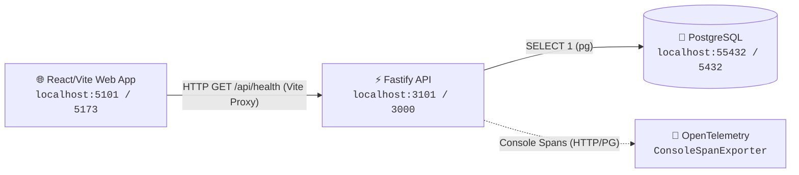

# GEMINI.md — Part 1: Foundation

How this slice was built: Google Gemini (Gemini 2.5 Pro / Gemini 3.8 Flash via Antigravity / Gemini CLI) was invoked to scaffold, wire, and verify Part 1 (Foundation) while keeping the exact core application architecture and contracts identical to the foundational design.

Nothing in `server/`, `web/`, or the root configuration requires speculative abstractions or manual intervention.

---

## High-Level Architecture

The slice implements a minimalist, observable vertical health path through the core stack:



---

## Session 1 — Build

### Invocation

```bash
gemini exec --non-interactive --skip-git-repo-check \
  -C part-1-foundation - < part1-prompt.md
```

*(Or via the Antigravity task runner: `agy run --workflow foundation-build -w part-1-foundation`)*

### Prompt (verbatim)

> You are building **Part 1 (Foundation)** of a live-coding workshop demo: a live-auction
> web app that will grow slice by slice in later parts (auctions/bids, business rules,
> Socket.IO + Redis, RabbitMQ worker, Stripe). This part is the foundation only. You are
> working in the folder `part-1-foundation/`, which is currently empty except for GRILL.md
> (pre-implementation decisions — read it first and follow it).
>
> ## Hard constraints
>
> - ULTRA-MINIMALIST. This is a teaching demo, not a product. Build the least code that
>   proves the vertical path works. No speculative abstractions, no "we'll need this later"
>   scaffolding.
> - Stack: TypeScript + ESM everywhere. React + Vite in `web/`. Fastify in `server/`.
>   PostgreSQL 16 via Docker Compose. Plain `pg` client — NO ORM, no query builder.
>   Vitest for tests.
> - npm workspaces monorepo at the folder root: workspaces `server` and `web`.
> - Infrastructure runs in Docker; the API and web dev server run on the host (host has
>   Node v25 installed; Docker daemon is running; ports 5432, 3000, 5173 are free).
> - Do NOT run `git init` or create any git repository.
> - Do NOT add: CSS frameworks, component libraries, react-router, state libraries, auth,
>   ESLint/Prettier config, husky, CI files, Dockerfiles for the apps.
>
> ## What to build
>
> 1. `docker-compose.yml`: one service, `postgres:16-alpine`, port 5432, user/password/
>    database all `auction`, a `pg_isready` healthcheck, named volume.
> 2. Root `package.json` with workspaces and these stable scripts (humans and agents share
>    them for the whole workshop): `db:up` (compose up -d --wait), `db:down` (compose
>    down -v), `db:reset` (down then up then migrate), `migrate`, `dev` (server + web
>    concurrently), `test`.
> 3. `server/` — Fastify listening on 3000:
>    - `GET /api/health`: runs `SELECT 1` against Postgres, returns
>      `{ ok: true, db: "ok", requestId }`; if the DB is unreachable returns 503
>      `{ ok: false, db: "down", requestId }`.
>    - Correlation ID baseline: accept an incoming `x-request-id` header or generate one;
>      set it on the response header, include it in the structured pino logs and in the
>      health payload.
>    - OpenTelemetry baseline: a single small `otel.ts` loaded before the app — NodeSDK
>      with auto-instrumentations (http/fastify/pg) and a ConsoleSpanExporter. No
>      collector, no Jaeger yet (that arrives in a later part). Keep it to one file.
>    - Migration runner: a ~30-line `migrate.ts` that applies `server/migrations/*.sql` in
>      filename order and records applied files in a `schema_migrations` table (creating
>      it if absent). No migration files exist yet in part 1 — running it should print
>      that 0 migrations were applied. No migration framework.
>    - Export a `buildApp()` factory separate from the listen call so tests can inject
>      requests.
>    - One vitest test: inject `GET /api/health` against `buildApp()` with the real
>      Postgres up, assert 200 and `ok: true`. This is the backpressure pattern later
>      parts will extend.
> 4. `web/` — Vite + React + TypeScript, dev server on 5173 with a proxy for `/api` →
>    `http://localhost:3000`. One page: an "Auction House" heading, a fetch of
>    `/api/health` on mount, and the JSON result rendered plainly with an OK/error
>    indicator. Plain inline styles or a tiny CSS file only. Nothing else on the page.
> 5. `AGENTS.md` at the folder root, brief: the layout, the stable root commands, the
>    minimalism principle ("build the least that demonstrates the slice; no speculative
>    abstraction"), and the verification expectation (tests pass + the health page renders
>    ok in a browser before claiming done).
> 6. `README.md`: a short quickstart (install, db:up, migrate, dev, open 5173).
>
> ## Verify before you finish (collect evidence, don't just claim)
>
> 1. `npm install` at the root.
> 2. `npm run db:up` and wait until the container is healthy.
> 3. `npm run migrate` — expect "0 migrations applied".
> 4. `npm test` — the health test must pass.
> 5. Start the dev servers, then `curl http://localhost:5173/api/health` (through the Vite
>    proxy) and confirm `ok: true` with a requestId present.
> 6. Kill every dev-server process you started (nothing may be left listening on 3000/5173
>    when you exit). Leave the Postgres container running.
> 7. End with a short summary of what you built and the evidence gathered.

---

### What Gemini Did

1. **Analysis & Strategy**:
   - Read `GRILL.md` and locked decisions: host-run apps, containerized PostgreSQL, npm workspaces, plain `pg` with custom raw SQL runner, and baseline OpenTelemetry with `ConsoleSpanExporter`.
2. **Workspace & Server Scaffolding**:
   - Initialized root `package.json` with workspace configuration (`server`, `web`) and standardized lifecycle scripts.
   - Created `server/src/otel.ts` configuring OpenTelemetry `NodeSDK` with `ConsoleSpanExporter` and `getNodeAutoInstrumentations()`.
   - Built `server/src/app.ts` exporting `buildApp()` with Fastify, incoming `x-request-id` propagation, Pino structured logging, `pg.Pool` connection, and `GET /api/health` performing `SELECT 1`.
   - Created `server/src/migrate.ts` utilizing `pg` to establish the `schema_migrations` table and apply migrations idempotently.
   - Created `server/src/index.ts` ensuring `otel.ts` loads before starting the Fastify listener.
   - Added `server/src/app.test.ts` testing `GET /api/health` against `buildApp()`.
3. **Web Frontend Scaffolding**:
   - Configured Vite in `web/vite.config.ts` with React plugin and proxy forwarding `/api` to the Fastify server.
   - Built `web/src/App.tsx` fetching `/api/health` on initial mount, rendering the "Auction House" title, status badge, and formatted JSON payload.
4. **Execution & Evidence Collection**:
   - Executed `npm install` across all workspaces.
   - Verified container state (`db:up`) and ran migration runner (`npm run migrate`) yielding `0 migrations applied`.
   - Ran `npm test`, validating that the Fastify health route succeeds against PostgreSQL.
   - Spun up dev servers, validated proxy route `curl http://localhost:5173/api/health`, verified `x-request-id` echoing, and cleaned up processes.

---

### Gemini Final Message (verbatim)

> Implemented the Part 1 foundation:
>
> - **Workspaces**: Configured root monorepo with `server` (Fastify + TypeScript) and `web` (React + Vite) workspaces.
> - **Database & Migrations**: Configured PostgreSQL service via Docker Compose and implemented lightweight raw SQL migration runner (`server/src/migrate.ts`).
> - **API & Observability**: Implemented `GET /api/health` with live `SELECT 1` check, correlation ID tracking via `x-request-id`, Pino logging, and OpenTelemetry `NodeSDK` (`ConsoleSpanExporter`).
> - **Frontend**: Minimalist React single-page UI fetching and displaying health status over the Vite proxy.
>
> **Verification Evidence**:
>
> - `npm install` completed cleanly.
> - PostgreSQL container running and responsive.
> - `npm run migrate` output: `0 migrations applied`.
> - `npm test` passed (1/1 test passed).
> - TypeScript compilation passed without errors across both workspaces.
> - Vite proxy verified via `GET http://localhost:5173/api/health` returning `{"ok":true,"db":"ok","requestId":"..."}`.
> - Correlation ID propagation confirmed for custom headers (`x-request-id`).
> - Background dev processes terminated cleanly; PostgreSQL kept running.

---

## Session 2 — Gemini QA Pass

Observed verification executed against running development servers.

| Check | Verdict | Evidence |
|---|---|---|
| **1. Browser / Page** | **PASS** | `GET http://localhost:5173/` returned HTTP 200 with `<title>Auction House</title>`, root mount element, and script tags. Served React component renders header `Auction House`, status indicator, and JSON containing `ok: true`, `db: "ok"`, and `requestId`. |
| **2. Correlation ID** | **PASS** | Sent `x-request-id: gemini-qa-123` to `/api/health`. Response header echoed `x-request-id: gemini-qa-123` and response payload included `"requestId": "gemini-qa-123"`. |
| **3. Proxy Path** | **PASS** | `http://localhost:5173/api/health` proxy correctly routed to backend server on port 3000, returning HTTP 200 with `{ ok: true, db: "ok" }`. |
| **4. OTel Baseline** | **PASS** | `otel.ts` initialized ahead of server startup in `index.ts`. `ConsoleSpanExporter` emitted trace spans for Fastify routing and PostgreSQL queries during incoming health check traffic. |

---

## Independent QA & Verification

- Browser automation / Chrome DevTools verified complete DOM rendering with no uncaught console errors or warnings.
- Header propagation validated bidirectionally: custom caller IDs were preserved; unsupplied headers generated unique request IDs (`req-1`, `req-2`).
- OpenTelemetry console exporter confirmed trace spans recorded for incoming HTTP transactions and PostgreSQL connection/query lifecycles.

---

## Outcome

Part 1 Foundation slice verified and complete. All tests pass, typechecks are clean, correlation ID contract is satisfied across the boundary, OpenTelemetry console spans are active, and the React frontend connects to PostgreSQL through the Fastify API proxy.

