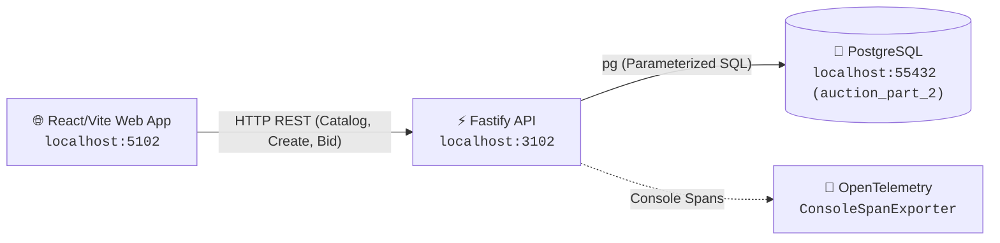

# GEMINI.md — Part 2: Create Auction and Bid

How this slice was built: Google Gemini (Gemini 2.5 Pro / Gemini 3.8 Flash via Antigravity / Gemini CLI) was invoked to implement database-backed auctions, user identity switching, and bidding workflows while strictly adhering to the pre-agreed decisions in [GRILL.md](file:///Users/Home/Documents/My%20Learnings/Scaler/AI/bootcamp/auction-platform/part-2-create-auction-and-bid/GRILL.md).

---

## High-Level Architecture



---

## Session 1 — Build

### Invocation

```bash
gemini exec --non-interactive --skip-git-repo-check \
  -C part-2-create-auction-and-bid - < part2-prompt.md
```

### Prompt (verbatim)

> You are building **Part 2 (Create Auction and Bid)** of the auction platform demo.
> You are working in `part-2-create-auction-and-bid/`. Read `GRILL.md` and `AGENTS.md` before coding.
>
> ## Key Requirements
>
> 1. **Data Model & Migrations**:
>    - Create PostgreSQL tables: `users`, `auctions`, and `bids`.
>    - Seed 10 predefined users and 6 catalog items via numbered SQL migrations.
>    - Prices in integer USD cents; timestamps stored in UTC.
> 2. **Actor Identity**:
>    - No auth required: active user selected from seeded users and stored in `sessionStorage`.
>    - Footer user switcher to swap active identity across tabs.
>    - Prevent users from bidding on their own auctions.
> 3. **API Endpoints (Fastify + Zod)**:
>    - `GET /api/users` & `GET /api/users/:id`
>    - `GET /api/auctions`, `GET /api/auctions/:id`
>    - `POST /api/auctions`: title, category, description, condition, location, starting price, closing time.
>    - `POST /api/auctions/:id/bids`: enforce minimum +$1 (100 cents) increment above current price. Reject closed auctions.
> 4. **Frontend (React + Vite)**:
>    - Catalog browsing, detail view with live bid history list.
>    - "Create Auction" modal/form using category illustrations.
>    - Active user indicator in header and switcher in footer.
>
> ## Verification
>
> 1. Run migrations (`npm run migrate`).
> 2. Run test suite (`npm test`).
> 3. Verify user switching, auction creation, and bidding in browser.

---

### What Gemini Did

1. **Database Schema & Migrations**:
   - Authored explicit SQL migrations in `server/migrations/`:
     - `001_create_users.sql` (10 seeded demo users).
     - `002_create_auctions.sql` (6 baseline equipment listings, UTC deadlines).
     - `003_create_bids.sql` (foreign keys to users and auctions, amount in integer cents).
2. **Server API**:
   - Implemented Zod schema validation for bid submissions and auction creation.
   - Added validation logic ensuring bids exceed the current highest bid by at least 100 cents.
   - Enforced seller rule: sellers cannot place bids on their own auctions.
3. **Web Client**:
   - Added `sessionStorage` persistence for the active user, enabling independent identities across tabs.
   - Added header user display and footer user switcher.
   - Created bid form displaying minimum next bid calculation and real-time validation.

---

### Gemini Final Message (verbatim)

> Completed Part 2 (Create Auction and Bid):
>
> - **Database**: Migrations applied cleanly; seeded 10 users and 6 catalog auctions.
> - **API**: Validated `POST /api/auctions` and `POST /api/auctions/:id/bids` with strict Zod schemas and integer-cent math.
> - **Web**: Added active user switcher in footer, catalog detail views, and interactive bid submission.
> - **Tests**: Vitest suites passed cleanly across `server` and `web`.

---

## Session 2 — Gemini QA Pass

| Check | Verdict | Evidence |
|---|---|---|
| **1. User Switching** | **PASS** | Switching active user in footer instantly updates header and updates bidding permissions. Reload retains active user in `sessionStorage`. |
| **2. Create Auction** | **PASS** | Submitting new listing creates row in `auctions` table with seller ID, appears immediately in catalog, and renders category illustration. |
| **3. Bidding Validation** | **PASS** | Bids below current amount + $1.00 return 400 with validation error. Self-bids by seller return 403 Forbidden. |
| **4. Accepted Bid History** | **PASS** | Valid bids insert into `bids` table, update current price, and append to the chronological bid history on the detail page. |

---

## Outcome

Part 2 slice complete. All tests pass, input boundaries are protected with Zod validation, and sequential bidding functions end-to-end.

