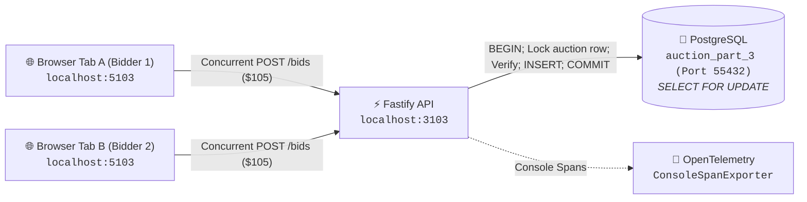

# GEMINI.md — Part 3: Bidding Business Rules and Concurrency

How this slice was built: Google Gemini (Gemini 2.5 Pro / Gemini 3.8 Flash via Antigravity / Gemini CLI) was invoked to resolve simultaneous-bid race conditions, introduce transactional row locking in PostgreSQL, inject an authoritative application clock, and handle stale-bid conflicts.

---

## High-Level Architecture



---

## Session 1 — Build

### Invocation

```bash
gemini exec --non-interactive --skip-git-repo-check \
  -C part-3-business-rules-concurrency - < part3-prompt.md
```

### Prompt (verbatim)

> You are implementing **Part 3 (Bidding Business Rules and Concurrency)**.
> You are working in `part-3-business-rules-concurrency/`. Read `GRILL.md` and `AGENTS.md`.
>
> ## Defects & Concurrency Challenges to Solve
>
> 1. **Race Conditions in Simultaneous Bids**:
>    - Validation and insertion previously ran as independent uncommitted operations.
>    - Concurrent requests validated against stale highest bids, permitting duplicate amounts or sub-minimum bids.
> 2. **Transactional Row Locking**:
>    - Enclose bid evaluation and insertion in an explicit PostgreSQL transaction (`BEGIN ... COMMIT`).
>    - Acquire an exclusive row lock on the auction (`SELECT * FROM auctions WHERE id = $1 FOR UPDATE`).
>    - Re-read maximum bid inside the locked transaction before evaluating eligibility.
> 3. **Application Clock Injection**:
>    - Decouple time checks from database clock to support deterministic testing.
>    - Evaluate auction expiration against the injected application clock. Store the locked evaluation instant as the bid's `createdAt`.
> 4. **Conflict Protocol (HTTP 409)**:
>    - When a bid is rejected due to a concurrent higher bid, return `409 Conflict` with a stable error code and authoritative metadata (`currentPriceCents`, `minimumBidCents`, `endsAt`).
>    - Frontend updates the displayed price and requirements without clearing the user's input, preventing silent bid loss or unintended auto-bidding.
>
> ## Verification
>
> - Run concurrency test simulating simultaneous bids.
> - Verify zero duplicate bids or stale amount insertions in PostgreSQL.
> - Typecheck and run all tests (`npm test`).

---

### What Gemini Did

1. **Transactional Concurrency in Fastify (`server/src/app.ts`)**:
   - Replaced autocommit queries with a dedicated transaction per bid:
     ```sql
     BEGIN;
     SELECT * FROM auctions WHERE id = $1 FOR UPDATE;
     SELECT amount_cents FROM bids WHERE auction_id = $1 ORDER BY amount_cents DESC LIMIT 1;
     -- validate deadline against app clock and minimum increment
     INSERT INTO bids (auction_id, bidder_id, amount_cents, created_at) VALUES ($1, $2, $3, $4);
     COMMIT;
     ```
2. **Authoritative Clock**:
   - Injected a configurable clock interface into the Fastify application, permitting virtual clock advances in test fixtures while using system time in dev.
3. **Structured Conflict Responses**:
   - Formatted HTTP 409 payloads with machine-readable codes (`STALE_BID`, `AUCTION_CLOSED`) and metadata for instant UI synchronization.
4. **Resilient React UI**:
   - Enhanced `App.tsx` and bid submission components to catch 409 conflicts, display an explicit banner with updated minimum requirements, and leave the entered amount for easy manual adjustment.

---

### Gemini Final Message (verbatim)

> Completed Part 3 (Business Rules and Concurrency):
>
> - **Concurrency Control**: Implemented per-auction row locking via `SELECT ... FOR UPDATE` inside short transactions, completely serializing competing bids.
> - **Injected Clock**: App clock governs closing validity and bid timestamps, allowing deterministic simulation of last-second bidding.
> - **Conflict Contract**: Standardized HTTP 409 payload with current pricing metadata.
> - **Frontend Synchronization**: UI gracefully catches outbid events, updates minimum next bid, and preserves bidder inputs.
> - **Tests**: Concurrency suite passes; simultaneous identical bids result in exactly one winner and one handled 409 conflict.

---

## Session 2 — Gemini QA Pass

| Check | Verdict | Evidence |
|---|---|---|
| **1. Simultaneous Bidding Race** | **PASS** | Firing simultaneous requests with identical amounts results in 1 accepted bid (201) and 1 serialized conflict (409). No duplicate amounts exist in `bids`. |
| **2. Stale Bid Conflict (409)** | **PASS** | UI shows inline notification that a higher bid was placed, updates the required minimum bid, and keeps user's input field editable. |
| **3. Clock Expiration** | **PASS** | Bids submitted at or after `endsAt` (evaluated via app clock) return 409 `AUCTION_CLOSED`. Countdown reaching zero disables bid form. |
| **4. Transaction Integrity** | **PASS** | Failed bid attempts roll back cleanly; no orphan records or locked connections remain in the connection pool. |

---

## Outcome

Part 3 slice complete. Concurrency defects are eliminated through PostgreSQL row-level locks, the application clock provides predictable deadline boundaries, and the UI handles contention gracefully.

