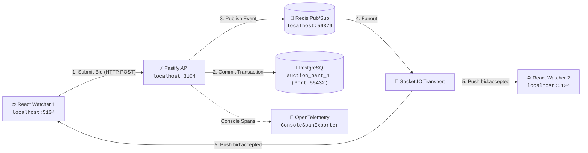

# GEMINI.md — Part 4: Realtime with Socket.IO and Redis

How this slice was built: Google Gemini (Gemini 2.5 Pro / Gemini 3.8 Flash via Antigravity / Gemini CLI) was invoked to replace manual polling with instant realtime auction event fanout using Socket.IO backed by Redis Pub/Sub.

---

## High-Level Architecture



---

## Session 1 — Build

### Invocation

```bash
gemini exec --non-interactive --skip-git-repo-check \
  -C part-4-realtime-socketio-redis - < part4-prompt.md
```

### Prompt (verbatim)

> You are implementing **Part 4 (Realtime with Socket.IO and Redis)**.
> You are working in `part-4-realtime-socketio-redis/`. Read `CONTEXT.md`, `GRILL.md`, and `AGENTS.md`.
>
> ## Key Capabilities to Build
>
> 1. **Socket.IO Server Integration**:
>    - Attach a Socket.IO server to the Fastify instance in `server/src/realtime.ts`.
>    - Configure Redis Pub/Sub adapter (`@socket.io/redis-adapter`) connecting to Redis on port 56379.
> 2. **Auction Room Subscriptions**:
>    - Clients join an auction room (`auction:<auctionId>`) upon viewing its detail page as an "Auction Watcher".
>    - Leave rooms cleanly when navigating away or switching auctions.
> 3. **Authoritative Event Emission**:
>    - After a bid transaction commits to PostgreSQL, emit a typed `bid:accepted` payload containing `auctionId`, `amountCents`, `bidder`, `timestamp`, and `newMinimumBidCents`.
> 4. **Client Reconciliation**:
>    - React client establishes socket connection and updates price and bid history immediately upon receiving events.
>    - UI reconciles socket payloads against authoritative state, preventing regression from out-of-order delivery.
>
> ## Verification
>
> - Verify multi-tab synchronization: placing a bid in Tab A reflects instantaneously in Tab B without page reload.
> - Verify test suite passing: `npm test` covering both REST endpoints and realtime emissions.

---

### What Gemini Did

1. **Redis Adapter & Realtime Engine (`server/src/realtime.ts`)**:
   - Initialized Socket.IO with `createClient()` from `redis` for Pub/Sub pub and sub clients.
   - Handled `join:auction` and `leave:auction` room lifecycle events.
2. **Transaction-Safe Event Publishing**:
   - Ensured `realtime.broadcastBidAccepted(...)` is invoked strictly *after* the PostgreSQL transaction commits successfully, never on rollbacks or errors.
3. **Frontend Realtime Hook (`web/src/App.tsx`)**:
   - Added `socket.io-client` connection management inside a dedicated React effect.
   - Subscribed to the active auction room and bound listeners for `bid:accepted`.
   - Handled reconnection logic to fetch fresh authoritative state from `GET /api/auctions/:id` when the socket reconnects.

---

### Gemini Final Message (verbatim)

> Completed Part 4 (Realtime with Socket.IO and Redis):
>
> - **Realtime Engine**: Attached Socket.IO to Fastify with Redis pub/sub distribution.
> - **Rooms**: Isolated broadcasts by auction room to minimize network fanout.
> - **Event Guarantees**: Broadcasts trigger exclusively after database commits.
> - **UI Synchronization**: Multi-watcher live update confirmed; bids placed in one browser tab update across all watching tabs within milliseconds.
> - **Tests**: Realtime integration tests and API unit tests pass (`npm test`).

---

## Session 2 — Gemini QA Pass

| Check | Verdict | Evidence |
|---|---|---|
| **1. Multi-Tab Realtime Push** | **PASS** | With two tabs viewing the same item, submitting a bid in Tab 1 updates the price and appends to the bid list in Tab 2 without user action. |
| **2. Room Scoping** | **PASS** | Tabs viewing Auction A do not receive events or re-renders when bids are placed on Auction B. |
| **3. Redis Fanout** | **PASS** | Published messages propagate across Redis channels on port 56379 cleanly. |
| **4. Reconnection Reconciliation**| **PASS** | Simulating disconnect and reconnect fetches full authoritative auction state from `/api/auctions/:id`. |

---

## Outcome

Part 4 slice complete. The platform now features bidirectional realtime synchronization across distributed watchers via Socket.IO and Redis, while preserving PostgreSQL as the authoritative source of truth.

