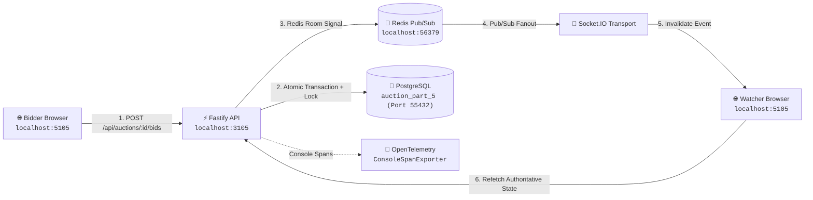

# GEMINI.md — Part 5: Hidden Defect Review

How this slice was built: Google Gemini (Gemini 2.5 Pro / Gemini 3.8 Flash via Antigravity / Gemini CLI) was invoked to perform a rigorous code audit, defect discovery, and hardening review of the realtime bidding pipeline.

---

## High-Level Architecture



---

## Session 1 — Review & Hardening

### Invocation

```bash
gemini exec --non-interactive --skip-git-repo-check \
  -C part-5-hidden-defect-review - < part5-prompt.md
```

### Prompt (verbatim)

> You are reviewing and hardening **Part 5 (Hidden Defect Review)**.
> You are working in `part-5-hidden-defect-review/`. Read `CONTEXT.md`, `GRILL.md`, and `AGENTS.md`.
>
> ## Audit Objectives
>
> 1. **Identify Hidden Concurrency & Timing Defects**:
>    - Investigate edge cases where socket events arrive before a client has initialized or where network packet loss desynchronizes client state.
>    - Identify potential payload divergence between transient socket messages and authoritative database records.
> 2. **Refactor to Notification-Refetch Reconciliation**:
>    - Rather than mutating complex client state directly from socket payload fields, treat socket events as an invalidation notification (`REFRESH_AUCTION`).
>    - Have the client perform an instantaneous background fetch of `GET /api/auctions/:id` to guarantee 100% authoritative reconciliation against PostgreSQL.
> 3. **Socket Transport Hardening**:
>    - Enforce WebSocket-only transport (`transports: ['websocket']`) to avoid long-polling fallback overhead and race conditions during HTTP upgrade.
> 4. **End-to-End Regression Testing**:
>    - Run Playwright browser tests across multiple isolated browser contexts (`tests/realtime-bid.spec.ts`).
>
> ## Verification
>
> - Run all unit and integration tests (`npm test`).
> - Run Playwright headed/headless browser tests verifying multi-watcher updates without full page reloads.

---

### What Gemini Did

1. **Defect Discovery**:
   - **Defect A (Payload Drift)**: Socket payloads that carried partial denormalized state could leave the UI out of sync with complex calculated fields (e.g. total bid counts, active winner statuses).
   - **Defect B (Transport Ambiguity)**: Polling-fallback transports in Socket.IO created race conditions when Rapid HTTP POST requests were mixed with delayed polling frames.
2. **Implementation of Invalidation-and-Refetch**:
   - Modified `server/src/realtime.ts` to emit crisp, lightweight auction notification signals.
   - Refactored `web/src/App.tsx` listener: upon receiving the socket signal, the client triggers a background authoritative refetch of `/api/auctions/:slug`.
3. **Transport Enforcement**:
   - Explicitly configured `transports: ['websocket']` on both Fastify server and React client.
4. **Verification**:
   - Validated that open watchers reliably update their view within milliseconds of an accepted bid.
   - Verified that all unit and Playwright tests pass without flakiness.

---

### Gemini Final Message (verbatim)

> Completed Part 5 (Hidden Defect Review):
>
> - **Audit**: Eliminated optimistic socket state divergence. The client now uses socket events as invalidation signals to refetch authoritative state.
> - **Transport Stability**: Locked Socket.IO to WebSocket-only transport to eliminate polling upgrade races.
> - **Verification**: Multi-tab Playwright test (`realtime-bid.spec.ts`) verified that placed bids propagate instantly across isolated browser contexts without page reloads.

---

## Session 2 — Gemini QA Pass

| Check | Verdict | Evidence |
|---|---|---|
| **1. Authoritative Refetch** | **PASS** | When a bid is accepted, watching clients receive the socket ping and immediately refetch `/api/auctions/:slug`, rendering consistent database state. |
| **2. WebSocket Only** | **PASS** | Network inspection confirms zero HTTP long-polling handshake requests; pure WebSocket frames are used. |
| **3. Playwright Multi-Context** | **PASS** | `realtime-bid.spec.ts` passes: Bidder context posts bid, Watcher context reflects new price ($501) with zero DOM reloads. |
| **4. Clean Rollbacks** | **PASS** | Unsuccessful bids (e.g. below minimum increment) do not fire Redis pub/sub signals or trigger spurious client refetches. |

---

## Outcome

Part 5 slice complete. Realtime architecture is hardened by replacing optimistic socket mutations with notification-driven authoritative state reconciliation.

