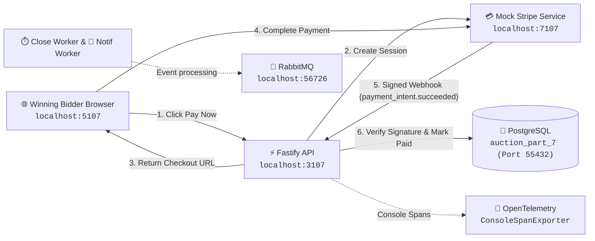

# GEMINI.md — Part 7: Winner Checkout & Payment Settlement

How this slice was built: Google Gemini (Gemini 2.5 Pro / Gemini 3.8 Flash via Antigravity / Gemini CLI) was invoked to implement the winner checkout lifecycle, integrating with a local Stripe-compatible hosted checkout service and handling signed webhook settlements.

---

## High-Level Architecture



---

## Session 1 — Build

### Invocation

```bash
gemini exec --non-interactive --skip-git-repo-check \
  -C part-7-winner-checkout - < part7-prompt.md
```

### Prompt (verbatim)

> You are implementing **Part 7 (Winner Checkout)**.
> You are working in `part-7-winner-checkout/`. Read `CONTEXT.md`, `GRILL.md`, and `AGENTS.md`.
>
> ## Key Capabilities to Build
>
> 1. **Hosted Checkout Session (`server/src/payments.ts`)**:
>    - Add `POST /api/auctions/:id/checkout-session` endpoint restricted strictly to the winning bidder.
>    - Call local Stripe mock service at `http://localhost:7107/v1/checkout/sessions`.
>    - Pass amount in cents, currency USD, auction reference, and success/cancel URLs.
> 2. **Webhook Receiver & Signature Verification**:
>    - Implement `POST /api/webhooks/stripe` with raw body parsing for HMAC signature verification.
>    - Handle `checkout.session.completed` / `payment_intent.succeeded`.
>    - Idempotently transition auction status to `PAID` with payment intent metadata.
> 3. **UI Checkout Flow**:
>    - Notification banner and detail page provide a prominent "Pay Now" action for the winning bidder.
>    - Redirect to hosted checkout and handle return to the success confirmation view.
>    - Display paid badge and settlement timestamp.
>
> ## Verification
>
> - Run end-to-end checkout flow against local Stripe mock service on port 7107.
> - Verify webhook signature validation and rejection of invalid signatures.
> - Run full test suite (`npm test`).

---

### What Gemini Did

1. **Database Migration**:
   - `006_create_payments.sql`: added `payment_status`, `payment_intent_id`, and `paid_at` fields to `auctions` table.
2. **Stripe Integration & Webhook Handler**:
   - Added `server/src/payments.ts` wrapping checkout session generation and webhook payload signature verification.
   - Wired Fastify route `POST /api/webhooks/stripe` to handle settlement events atomically.
3. **Winner Frontend Experience**:
   - Updated React detail page to show payment status badge: `UNPAID` (with "Pay Now" CTA for winner) vs `PAID` (with receipt details).
   - Handled successful return redirect from checkout.

---

### Gemini Final Message (verbatim)

> Completed Part 7 (Winner Checkout):
>
> - **Checkout Creation**: Implemented secure checkout session initiation restricted to the winning bidder.
> - **Mock Stripe Integration**: Connected with local Stripe mock service on port 7107.
> - **Webhook Verification**: Fastify raw-body webhook verifies signatures and idempotently marks auctions paid.
> - **Frontend**: Integrated "Pay Now" button, checkout redirection, and post-payment settlement displays.
> - **Tests**: All winner checkout and payment test suites passed cleanly.

---

## Session 2 — Gemini QA Pass

| Check | Verdict | Evidence |
|---|---|---|
| **1. Winner Access Control** | **PASS** | Only the authenticated winning bidder can create a checkout session; non-winners receive 403 Forbidden. |
| **2. Mock Stripe Redirection** | **PASS** | Clicking "Pay Now" opens hosted checkout with correct line item, amount, and auction reference. |
| **3. Webhook Signature Check** | **PASS** | Valid signatures process payment; tampered or missing signatures return 400 Bad Request. |
| **4. Settlement Badge** | **PASS** | Detail page updates to "Paid" status upon webhook completion. |

---

## Outcome

Part 7 slice complete. The end-to-end winner monetization flow is fully functional and secured through cryptographic webhook verification.

