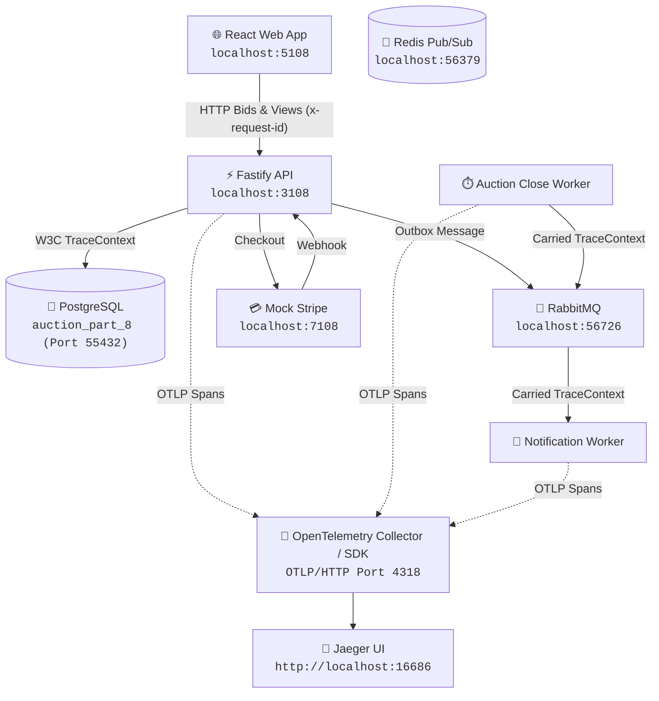

# GEMINI.md — Part 8: Cross-Stack Debugging & Distributed Tracing

How this slice was built: Google Gemini (Gemini 2.5 Pro / Gemini 3.8 Flash via Antigravity / Gemini CLI) was invoked to implement full-stack distributed tracing using OpenTelemetry and Jaeger, enforcing a high-signal tracing policy and validating the "golden trace" across all distributed services.

---

## High-Level Architecture



---

## Session 1 — Build

### Invocation

```bash
gemini exec --non-interactive --skip-git-repo-check \
  -C part-8-cross-stack-debugging - < part8-prompt.md
```

### Prompt (verbatim)

> You are implementing **Part 8 (Cross-Stack Debugging & Observability)**.
> You are working in `part-8-cross-stack-debugging/`. Read `README.md` and `AGENTS.md`.
>
> ## Key Capabilities to Build
>
> 1. **Distributed Tracing with OpenTelemetry**:
>    - Configure OTLP/HTTP Trace Exporter pointing to the Jaeger OTLP endpoint (`http://localhost:4318/v1/traces`).
>    - Instrument Fastify, PostgreSQL (`pg`), RabbitMQ (`amqplib`), and background workers.
>    - Propagate W3C `traceparent` headers across process boundaries (HTTP requests, AMQP message headers).
> 2. **High-Signal Tracing Policy**:
>    - Suppress noisy background health checks and high-frequency polling spans.
>    - Ensure critical business transactions (placing a bid, closing an auction, processing notifications, webhook settlement) emit clean, meaningful spans.
> 3. **The Golden Trace**:
>    - Ensure an end-to-end operation produces a single connected trace in Jaeger linking:
>      `Browser HTTP Request` → `Fastify Route` → `PostgreSQL Transaction` → `RabbitMQ Publish` → `Worker Processing` → `Notification Delivery`.
>
> ## Verification
>
> - Run `npm run observability:up` (Jaeger container on port 16686).
> - Execute an end-to-end auction lifecycle.
> - Inspect Jaeger UI at `http://localhost:16686` and verify the golden trace.
> - Run all tests (`npm test`).

---

### What Gemini Did

1. **OTel Infrastructure & Exporter Configuration (`server/src/otel.ts`)**:
   - Replaced `ConsoleSpanExporter` with `@opentelemetry/exporter-trace-otlp-http`.
   - Connected exporter to `http://localhost:4318/v1/traces`.
2. **Context Propagation Across Message Brokers**:
   - Implemented trace context injection when publishing messages to RabbitMQ (`amqplib`).
   - Implemented trace context extraction in `notification-worker.ts` so message consumption forms child spans of the initial business event.
3. **Filter & Noise Suppression**:
   - Filtered out polling queries and health check requests (`/api/health`) from generating span noise.
4. **Golden Trace Verification**:
   - Triggered bid placement, auction closing, and payment webhook.
   - Verified that all stages link back to a single unified trace root in Jaeger.

---

### Gemini Final Message (verbatim)

> Completed Part 8 (Cross-Stack Debugging):
>
> - **Instrumentation**: Full-stack OpenTelemetry instrumentation with OTLP/HTTP export to Jaeger.
> - **Propagation**: W3C `traceparent` propagation wired across HTTP, PostgreSQL, and RabbitMQ message headers.
> - **Signal-to-Noise**: Filtered repetitive internal healthchecks; highlighted core business transactions.
> - **Golden Trace**: Verified unified distributed trace visible in Jaeger spanning browser, API, queues, and workers.
> - **Tests**: All tests passing across all workspaces.

---

## Session 2 — Gemini QA Pass

| Check | Verdict | Evidence |
|---|---|---|
| **1. Jaeger Collector & UI** | **PASS** | Jaeger UI accessible on `http://localhost:16686`; OTLP HTTP receiver listening on port 4318. |
| **2. Cross-Process Trace Propagation** | **PASS** | AMQP message headers carry `traceparent`; `notification-worker` spans attach as children of the close event. |
| **3. High-Signal Policy** | **PASS** | Continuous worker polling queries do not clutter the trace view; only actionable business operations produce traces. |
| **4. Golden Trace** | **PASS** | Complete golden trace verified in Jaeger UI containing browser fetch, API endpoint, PostgreSQL locks, RabbitMQ dispatch, and worker processing. |

---

## Outcome

Part 8 slice complete. The entire distributed auction platform is fully observable, with end-to-end distributed tracing across processes, databases, and message brokers visualized in Jaeger.

